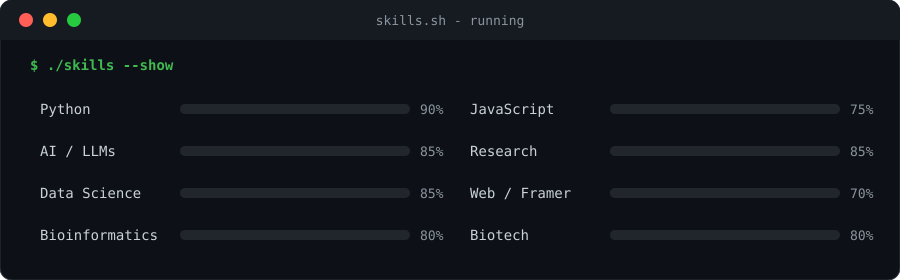
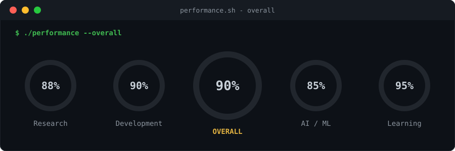

 

 

### `$ cat ~/skills`

 

### `$ ./performance --overall`

 

### `$ ./stats`

 

### `$ ./traits`

 

### `$ cat ~/id`

 

### `$ ls ~/research`

**1. Python-Driven Software Enhancing the Growth and Yield of Crop Production** &nbsp;`published`

My first research paper, published in IJSREM (Vol. 8, Issue 11, Nov 2024).

A Python program that helps farmers plan irrigation and plant care. It holds a dataset of crops with their ideal temperature range, base water need, pH range and minimum nutrients. The farmer enters the local temperature, and the program calculates the daily water requirement and suggests the right pH and nutrient levels. For example, tomatoes at 30°C need about 3.26 liters per day.

**Tech:** `Python` `Data Analysis` `Software Engineering`

[Read the paper →](https://ijsrem.com/download/python-driven-software-enhancing-the-growth-and-yield-of-crop-production/)

 

**2. An LLM-Based Agricultural Decision-Support System Integrating Environmental Monitoring, Disease Diagnosis, and Economic Forecasting** &nbsp;`in progress`

Vaibhav Vijay Shingade

An AI assistant for farmers that combines three things in one system: live environmental sensor readings, crop disease diagnosis from photos, and economic forecasting. An LLM brings these together to give farmers clear, practical advice.

**Tech:** `Gemma LLM` `Sensor Data` `Image-based Disease Diagnosis` `Forecasting Models`

Abstract

 

This paper presents an LLM-powered decision-support system tailored for the agricultural domain. The system unifies real-time environmental sensor data, AI-driven crop disease diagnosis from visual inputs, and economic forecasting models to provide farmers with holistic, actionable guidance, bridging the gap between cutting-edge AI research and ground-level agricultural practice.

`Large Language Models` `AgriTech` `Disease Diagnosis` `Economic Forecasting` `Environmental Monitoring` `AI`

 

